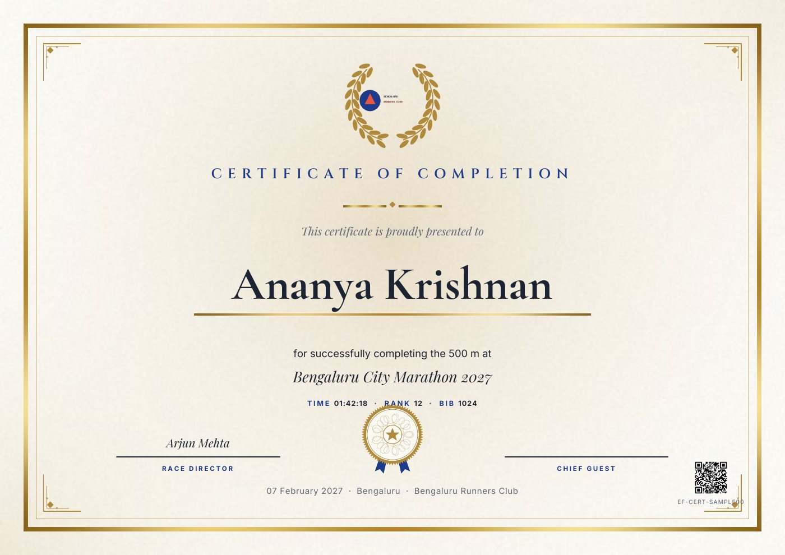
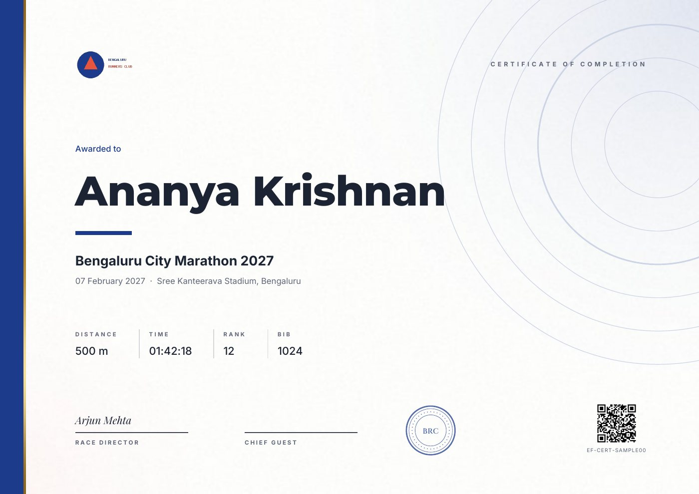
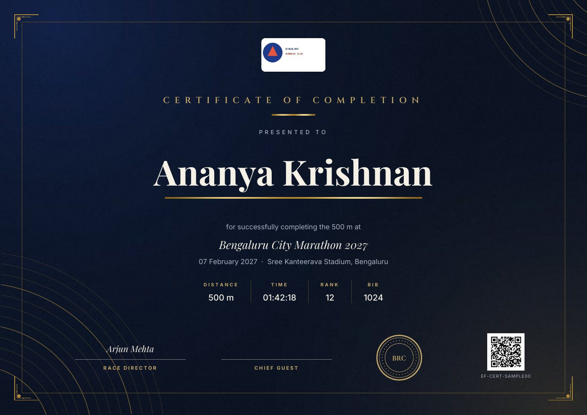
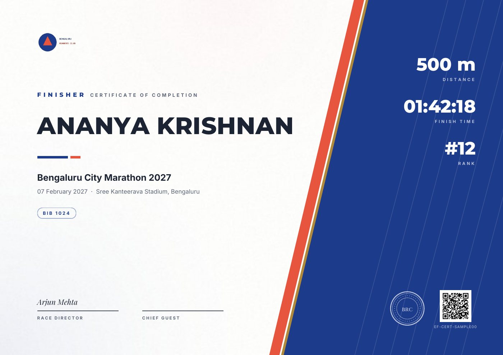
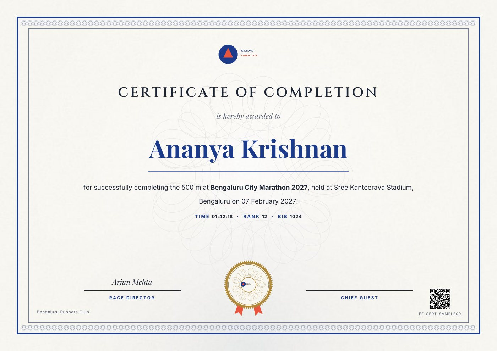
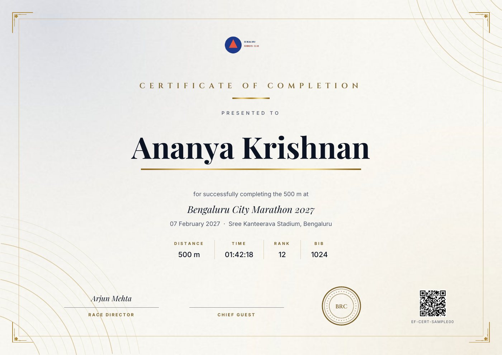

# EventFlow

White-label event registration SaaS for Indian skating and running races:
branded landing pages, paid registration (Cashfree or Razorpay), EF- passes
(PNG + PDF with a locally generated QR), and QR check-in.

Stack: Laravel 12, PHP 8.3, MySQL 8, Blade + Tailwind (Breeze), Pest, Docker (Sail locally,
nginx + php-fpm image behind Caddy in production).

## Quick start (local, about 5 minutes)

Needs Docker and PHP 8.3 + Composer (or only Docker: see the note below).

```bash
git clone https://github.com/Laaxxmm/eventflow.git && cd eventflow
cp .env.example .env
composer install
./vendor/bin/sail up -d                  # app :80, MySQL 8.4, Mailpit :8025, queue worker
./vendor/bin/sail artisan key:generate
./vendor/bin/sail artisan migrate --seed # demo org, users and the marathon
./vendor/bin/sail artisan events:sync    # every events/**/*.yaml -> events table
./vendor/bin/sail npm install && ./vendor/bin/sail npm run build
```

- App: http://localhost. Demo landing: http://localhost/demo-runners/bengaluru-city-marathon-2027
- Logins: `owner@demo.test` (organiser) and `volunteer@demo.test` (check-in), password `password`.
- Mail: set `MAIL_HOST=mailpit MAIL_PORT=1025` in `.env`, then read every email at http://localhost:8025.
- No local PHP? Install dependencies with Docker first:
  `docker run --rm -v "$PWD":/app -w /app composer:2 install --ignore-platform-reqs`.
- Without Docker: point `DB_*` at a local MySQL 8, then `php artisan migrate --seed && composer dev`.

## Tests

```bash
php artisan test                    # unit + feature (in-memory SQLite; CI runs them on MySQL 8.4)
php artisan test tests/Smoke        # end to end: register -> webhook -> pass mail -> check-in
./vendor/bin/pint --test            # code style
php artisan events:validate         # event YAML against events/schema.json
```

To run the suite on MySQL like CI: `DB_CONNECTION=mysql DB_HOST=127.0.0.1 DB_DATABASE=testing php artisan test`.

## Environment keys

`.env.example` (local) and [`deploy/env.example`](deploy/env.example) (staging/production) list every key.
Never commit a filled-in `.env`.

| Keys | What for |
|---|---|
| `APP_KEY`, `APP_URL` | `php artisan key:generate`; the public base URL (https in production). |
| `DB_*` | MySQL 8. `DB_HOST=mysql` inside Docker. |
| `PAYMENT_PROVIDER` | `cashfree` or `razorpay`: the default; an org's `payment_provider` overrides it. |
| `RAZORPAY_KEY_ID`, `RAZORPAY_KEY_SECRET`, `RAZORPAY_WEBHOOK_SECRET` | Razorpay API keys and webhook secret. |
| `CASHFREE_APP_ID`, `CASHFREE_SECRET_KEY`, `CASHFREE_ENV`, `CASHFREE_WEBHOOK_SECRET` | Cashfree API keys, `sandbox` or `production`, webhook signing key. |
| `MAIL_*` | Mailpit locally; Brevo SMTP or Amazon SES (SMTP) in production. Never Gmail SMTP. |
| `PASS_SIGNING_KEY` | HMAC key for pass QR codes (`openssl rand -hex 32`). Rotating it invalidates every issued QR. |
| `QUEUE_CONNECTION=database` | Pass PDFs and emails run on the queue worker. |
| `RCLONE_CONFIG_BACKUP_*`, `BACKUP_*` | Production only: nightly backups (see Ops). |

### Sandbox payment keys

Use test keys everywhere except production. The webhook URL is `https://<your domain>/webhooks/<provider>`.
Webhooks need a public URL, so test them on staging (or through a tunnel such as `cloudflared` locally).

**Razorpay** (Test Mode)
1. Dashboard → switch to **Test Mode** → Account & Settings → **API Keys** → Generate Test Key.
   Copy the `rzp_test_…` key id and secret into `RAZORPAY_KEY_ID` and `RAZORPAY_KEY_SECRET`.
2. Account & Settings → **Webhooks** → Add new webhook: URL `https://<domain>/webhooks/razorpay`,
   a secret of your choice (copy it into `RAZORPAY_WEBHOOK_SECRET`), events `payment.captured`,
   `payment.failed`, `order.paid`, `refund.processed`.
3. Pay with Razorpay's documented test cards or test UPI IDs; nothing is charged.

**Cashfree** (Sandbox)
1. Merchant dashboard → switch to **Test/Sandbox** → Developers → **API Keys**.
   Copy the App ID and Secret Key into `CASHFREE_APP_ID` and `CASHFREE_SECRET_KEY`; keep `CASHFREE_ENV=sandbox`.
2. Developers → **Webhooks** → add `https://<domain>/webhooks/cashfree` for payment success/failure.
   Cashfree signs webhooks with your secret key, so `CASHFREE_WEBHOOK_SECRET` is normally the same value.
3. Pay with Cashfree's documented sandbox cards or UPI.

Set `PAYMENT_PROVIDER` to pick the default. Both adapters implement `App\Contracts\PaymentGateway`;
nothing in the app is tied to one provider.

### Adding an event (YAML)

1. Copy `events/demo/example-marathon.yaml` to `events/<org-slug>/<event-slug>.yaml`.
2. Set `org` (the org's slug), `slug`, `name`, `date` (IST if no offset), `venue`, `branding` colours,
   `hero`, and priced `distances`. Pick a `sport:` pack (`skating`, `cycling`, `running`, `generic`) to
   inherit its age bands, form fields and race sheet; any key you set replaces the pack's.
   The full shape is [`events/schema.json`](events/schema.json).
3. `php artisan events:validate` (CI runs it too), then `php artisan events:sync`.
4. Open `/<org-slug>/<event-slug>`. On staging/production, merge to main and redeploy:
   `deploy/deploy.sh` runs `events:sync` after every deploy.

Organisers can also create and edit events in the app at `/organiser/events` (same config shape).

## Parallel sessions

See [docs/OWNERSHIP.md](docs/OWNERSHIP.md) for who owns which paths and
[docs/BRANCHES.md](docs/BRANCHES.md) for the branch workflow.

## Stream A: foundation & contracts (Session 1)

Contracts every other stream codes against. Change them only via a `feat/a-` PR.

| Contract | Purpose |
|---|---|
| `App\Contracts\PaymentGateway` | `createOrder`, `verifyWebhook`, `parseEvent`, `fetchStatus`, `refund`. Amounts are integer paise. |
| `App\Payments\Dto\{PaymentOrder, PaymentEvent, RefundResult}` | Readonly DTOs returned by gateways. |
| `App\Payments\PaymentStatus` | Enum `Pending, Paid, Failed, Refunded` (also `registrations.status`). |
| `App\Contracts\PassGenerator` | `generate(Registration): PassFiles` (png + pdf paths). No external QR APIs. |
| `App\Contracts\LandingSource` | `load(org, slug): EventConfig`. |
| `App\Landing\EventConfig` | Typed view of `events/schema.json`; `EventConfig::fromArray()`. |
| `App\Events\RegistrationPaid` | `registrationId`. Dispatched by payments (B), handled by passes (D). Fires after DB commit. |
| `App\Contracts\Entitlements` | Season Pass + module toggles: `activeSeasonPass(org)`, `enabled(org, Module)`. |
| `App\Contracts\SportPackRepository` | `get(Sport): SportPack` from `events/sports/<sport>.yaml`. |
| `App\Contracts\RaceSheetBuilder` | `build(Event): RaceSheet` (heats from `race_sheet` config). |
| `App\Contracts\CertificateRenderer` | `render(Registration): CertificateFile` (A4 PDF). |
| `App\Enums\{Sport, Module}` | `skating, cycling, running, generic`; `registration, payments, passes, checkin, race_sheets, certificates`. |
| `App\Support\EventSchema` | `errors($data, EventSchema::EVENT\|SPORT_PACK)`: the one shared validator. |
| `config/eventflow.php` | Payment provider + credentials, pass prefix/pattern/signing key, events paths, modules, race sheet presets, certificate gallery and A4 sizes. |

Schema (`database/migrations`): `orgs`, `users` (+`org_id`, `role` owner|staff|volunteer),
`events` (unique `org_id + slug`), `registrations` (`pass_no` EF-XXXXXXXXXXXX,
unique `gateway + gateway_order_id`), `payment_events` (unique `provider + event_id`).

Event configs: `events/schema.json` (JSON Schema draft-07), demo in
`events/demo/example-marathon.yaml`; `tests/Feature/ContractsTest.php` validates it.

Mail: Brevo SMTP or SES only (Mailpit locally). Queue: `database`.

### Accounts, roles and org scoping

- **Signup** (`/register`, ported from the prototype: organisation name, work
  email, optional phone, password) creates an `Org` with a unique slug
  (`sunrise-sports-club`, then `-2`, ...) and makes the organiser its **owner**.
  Email must be verified before the dashboard opens; password reset is Breeze's.
- **Roles** (`users.role`, `App\Enums\Role`): `owner`, `staff`, `volunteer`.
  Gates: `manage-org` (owner), `view-dashboard` and `export-participants`
  (owner, staff), `check-in` (any org member). Volunteers are sent to `/checkin`
  from every other page (`RestrictVolunteers`); stream F provides that route.
- **Org scope.** `Event`, `Registration`, `User` and `SeasonPass` use
  `App\Models\Tenancy\BelongsToOrg`: every query is filtered by the current
  org and new rows get its id. The current org is the logged-in user's, or one
  set explicitly with `app(CurrentOrg::class)->run($org, fn () => ...)` (use this
  on public pages, in jobs and in webhooks). With neither, queries are unfiltered.
  `registrations.org_id` always follows the event. `PaymentEvent` is deliberately
  unscoped (provider webhook log). Bypass on purpose only:
  `Model::withoutGlobalScope(OrgScope::class)`.
- **Rate limits**: 5/min/IP on login, signup, forgot and reset password
  (`throttle:auth`). Public registration routes must use `throttle:registration`
  (same limit, defined here).
- **Dashboard** (`/dashboard`): totals and per-event registrations, paid count,
  paid total (INR) and checked-in count. `/dashboard/participants` filters by
  event and status and exports CSV (custom answers as extra columns, spreadsheet
  formulas neutralised).

### Product rules

- **Season Pass, not per-event invoices.** A `season_passes` row (dates, status,
  included `modules`) grants an org a season. Core modules (registration,
  payments, passes) are always on, so an org can take entries before buying a
  season. Optional modules (check-in, race sheets, certificates, email
  branding, SMS/WhatsApp) need an active
  pass that includes them, and owners can switch them off in Org Settings
  (`orgs.modules`).
- **Sport packs.** `events.sport` / YAML `sport:` picks `events/sports/<sport>.yaml`.
  An event inherits each top-level key it omits (`distances`, `age_bands`, `fields`,
  `race_sheet`, `certificate`); keys it sets replace the pack's value entirely.
  Pack distances carry no price, so they must be priced per event.
- **Race sheets are config.** `race_sheet: {heat_size, group_by, seeding}`;
  `heat_size` presets 6/8/10, any N in 2..64. Heats never mix `group_by` groups.
  No `race_sheet` means a mass start.
- **Certificates.** `certificate.template` is a gallery key (`heritage-gold`,
  `modern-minimal`, `midnight-elite`, `stadium-strip`, `academic-seal`; see
  [Certificates](#certificates-1)) or `upload` with a `background` at exactly A4 300 dpi
  (3508x2480 landscape, 2480x3508 portrait). Custom layouts are not built in-app:
  organisers contact Indefine (`CUSTOM_TEMPLATE_CONTACT`).

Demos: `events/demo/example-marathon.yaml` (running, no heats) and
`events/demo/example-skating.yaml` (skating pack, heats of 6, uploaded certificate).

### Release smoke (integrator)

Before a tag, the integrator runs the end-to-end checklist and records results in
[docs/SMOKE.md](docs/SMOKE.md). `docs/smoke/local-e2e.py` drives a local stack
(`php artisan serve`, `queue:work`, Mailpit) through signup, registration rules,
signed webhooks for both gateways, the pass email, QR check-in, and dashboard vs CSV.
Sandbox checkout, Brevo and the phone scan are still run by hand on staging.

## Stream D: passes and check-in

When `RegistrationPaid` fires, the queued listener `App\Listeners\SendPass` builds the participant pass and queues `App\Mail\PassMail` (PNG + PDF attached).

- **Pass number.** The shipped contract is `EF-` + 12 uppercase hex (`config('eventflow.pass.pattern')`, same as the prototype). It is assigned with `Registration::newPassNo()` if a paid registration does not already have a matching number. `EF-{year}-{6 digits}` does not fit that pattern or the `pass_no` column comment, so it is not used.
- **QR.** Local PNG via `endroid/qr-code` (GD). Payload is `{pass_no}.{hmac-sha256}` using `PASS_SIGNING_KEY`. No external QR API.
- **Files.** `App\Passes\DomPdfPassGenerator` writes PNG (Intervention Image) and A4 PDF (DomPDF) to the `eventflow.pass.disk` disk, using event/org colours and the prototype layout (navy strip, participant, EF- number, scan-at-check-in QR).
- **Mail.** Queue the listener (`QUEUE_CONNECTION=database` in production; Mailpit locally, Brevo SMTP or SES from `.env` only). Run `php artisan queue:work`.
- **Check-in.** Volunteers, staff, and owners open `/checkin` on a phone. The camera uses `html5-qrcode` through Vite. `POST /checkin` verifies the HMAC inside a transaction, stamps `checked_in_at` once, and on a second scan returns the original IST time. A manual pass-number field is the fallback when the camera is unavailable.

```bash
# .env
PASS_SIGNING_KEY=   # php -r "echo bin2hex(random_bytes(32));"
QUEUE_CONNECTION=database
```

Tests: `php artisan test --filter=PassesTest`.

## Stream C: events, YAML landings & registration (Session 3)

Event YAML → database → branded landing → Pending registration → `/pay/{registration}`.

```bash
php artisan events:validate            # every event YAML under events/ (exits 1 on any error)
php artisan events:validate events/demo/example-marathon.yaml
php artisan events:sync                # upsert by org + slug into events.config (creates the org if missing)
php artisan events:sync --dry-run
php artisan events:sync --prune        # remove events of synced orgs that no YAML declares
```

Then open `/demo-runners` (org page) and `/demo-runners/bengaluru-city-marathon-2027` (landing).

| Piece | What it does |
|---|---|
| `App\Landing\YamlLandingSource` | `LandingSource` over `events/**/*.yaml` (sport packs skipped). Used by the commands. |
| `App\Landing\DatabaseLandingSource` | `LandingSource` bound in the container: published events from `events.config`. |
| `App\Landing\ConfigCompiler` | Applies the sport pack (`SportPack::applyTo`), pins dates without an offset to IST, validates with `App\Support\EventSchema` (the shared validator; no second one), returns `EventConfig`. |
| `App\Landing\YamlSportPackRepository` | `SportPackRepository` over `events/sports/<sport>.yaml`. |
| `App\Landing\RegistrationForm` | Builds the form and its server rules from `fields`, `distances`, `age_bands`. |
| `App\Landing\Capacity` | Places taken per distance: paid + pending younger than 30 min. |
| `App\Landing\EventForm` | Organiser setup screen (port of the prototype's `create-event.php`) ⇄ config shape. |

Rules:

- **Sync never deletes an event with registrations.** `--prune` closes those instead, and is skipped if
  any file failed. A sync (or editor save) that drops a distance with registrations is refused.
  `--prune` treats every event of a synced org as YAML-managed, so don't mix it with organiser-made
  events in the same org.
- **Registration form:** name, email, mobile, distance are always asked. When the event has `age_bands`
  or an `age` field, a date of birth is asked instead of age: age is computed **on race day** (IST) and
  must fall in a band; `answers` stores `dob`, `age`, `age_band` plus each configured field.
- **Tenancy:** public pages set `CurrentOrg` to the event's org, so a signed-in organiser of another org
  sees the same landing, places and review page as anyone else.
- **Capacity** is checked inside a transaction that locks the event row. Closed once the start time passes.
- **Hand-off:** a successful POST creates a `Pending` registration (`EF-` pass number, `amount_paise` from
  the distance) and redirects to a signed review page (`/r/{registration}/review`, 24 h) whose button
  POSTs to `payments.create` (`/pay/{registration}`).
- **Season Pass:** when an `Entitlements` implementation is bound, registration needs `Module::Registration`.
- **Organiser CRUD** at `/organiser/events` (auth + verified + `can:view-dashboard`, so owners and staff;
  events are org-scoped by `BelongsToOrg`).
  It writes `distances`, `age_bands` and `fields` explicitly; sport packs only prefill a new event.
  Slugs are generated from the name, unique per org, and fixed after creation.
- **Theme:** `branding.primary` / `secondary` become `--brand-*` CSS variables, with readable text colours
  computed from luminance. Logo/hero paths are served from the `public` disk; absolute URLs pass through.
- `/{org}` never matches reserved app paths (`login`, `dashboard`, `pay`, `organiser`, …); `routes/events.php`
  is required last in `routes/web.php`.

Tests: `tests/Feature/Events` (schema failure, capacity full, age out of band, sync safety, CRUD).

## Stream E: certificates, race sheets, Season Pass and Org Settings (Session 5)

Organiser-only (owner and staff, gate `view-dashboard`) pages under
`/dashboard/events/{event}/…` (`routes/reports.php`). Other orgs' events are 404
through the org scope; volunteers are sent to check-in.

### Certificates

- `/dashboard/events/{event}/certificates`: one click on **Generate
  certificates** queues `App\Certificates\BuildCertificateZip`, which renders an
  A4 PDF for every **checked-in, paid** runner and stores one ZIP. Progress
  (queued, running, ready, failed) is kept in the cache (`CertificateBatch`);
  the page offers **Download ZIP** when it is ready. A second click while a batch
  runs does nothing. Needs a queue worker (`queue` service in Sail).
- `App\Certificates\DomPdfCertificateRenderer` implements `CertificateRenderer`.
  Templates, palettes, issuing and verification are documented in the
  [Certificates](#certificates-1) section at the end of this README.
- One runner: `/dashboard/events/{event}/certificates/{registration}` (issues on first download).

### Race sheets

- `/dashboard/events/{event}/race-sheet` (page), `/race-sheet/csv`,
  `/race-sheet/pdf` (A4, with blank Time and Place columns for officials).
- `App\RaceSheets\HeatRaceSheetBuilder` implements `RaceSheetBuilder`: paid
  entrants grouped by `race_sheet.group_by` (default distance, age band,
  gender; any form field key works), in the config's distance and age band
  order, split **evenly** into heats of at most `heat_size` (9 with size 8 → 5 +
  4). `seeding: random` is seeded by the event id, so reprints match.
- Age band comes from the `age` answer and the event's `age_bands`; missing
  answers group as "Unspecified".
- Events without `race_sheet` (mass start) get start lists: same grouping, one
  list per group.

Tests: `tests/Feature/Reports` (fixtures in `tests/Feature/Reports/fixtures`:
a skating event YAML and an A4 background PNG).

### Season Pass and Org Settings

- `App\Entitlements\SeasonPassEntitlements` implements `Entitlements`: core
  modules (registration, payments, passes) are always on; check-in, race sheets,
  certificates, email branding and SMS/WhatsApp need an active pass (status `active`, today within its dates
  in IST, the latest-ending one wins) that includes them, and must not be
  switched off in Org Settings.
- **Enforcing a module on a route:**
  `->middleware(App\Entitlements\EnsureModuleEnabled::class.':checkin')`
  after `auth`; it checks the signed-in user's org and answers 403 with a
  pointer to Org Settings. Race sheets, certificates and check-in
  (`routes/checkin.php`, `:checkin`) use it.
- **Org Settings** (`/dashboard/settings`, owners only): shows the active pass
  and lets the owner switch optional modules off and on. Modules outside the
  pass are greyed out and can't be switched on. Stored in `orgs.modules`.
  Links to the notification settings (`/dashboard/settings/notifications`),
  whose add-ons go through the same `Entitlements` binding.
- **Granting a pass** (Indefine staff, until passes can be bought online):
  `php artisan season-pass:grant {org-slug} --plan="Season 2027" [--from=YYYY-MM-DD] [--until=YYYY-MM-DD] [--module=checkin --module=certificates] [--amount=25000]`.
  Defaults: today, 365 days, every optional module.

Tests: `tests/Feature/Entitlements`, `tests/Feature/Settings`.

## Ops: CI, Docker, staging and backups (Session 6)

### CI (`.github/workflows/tests.yml`)

| Job | What it checks |
|---|---|
| **Pint** | `pint --test` on every PHP file the PR (or push) adds or changes. The whole-repo run is report-only until older files are formatted. |
| **PHP 8.3 / 8.4 · MySQL 8.4** | `composer install`, `events:validate`, `php artisan test`, then `php artisan test tests/Smoke`, all against a MySQL 8.4 service. |
| **Docker image + staging stack** | Builds the production image and runs `deploy/deploy.sh --build` on the runner (Caddy on `https://localhost`), then the HTTP smoke check, a backup + restore test, and checks every service is up. |
| **Publish image** | On `main`: pushes `ghcr.io/laaxxmm/eventflow:main` and `:<sha>`. |
| **Deploy staging** | On `main`, when the repository variable `STAGING_HOST` is set: SSH in and run `deploy/deploy.sh` (secrets `STAGING_SSH_KEY`, `STAGING_USER`; optional variable `STAGING_APP_DIR`). |

### Production image (`Dockerfile`, `docker/`)

One image, three roles picked by `CONTAINER_ROLE`: `web` (nginx + php-fpm on :8080, runs migrations
when `RUN_MIGRATIONS=1`), `queue` (`queue:work`: passes and mail) and `scheduler` (`schedule:work`:
payment reconciliation). Code and built assets are baked in; config/routes/views are cached at start.
`storage/` is a volume. nginx trusts `X-Forwarded-*` from the private Docker network, so Laravel sees
HTTPS and client IPs behind Caddy.

### Staging on one VPS (about 15 minutes)

Any Ubuntu VPS with 2 GB RAM, Docker Engine + Compose plugin, ports 80/443 open.

```bash
# 1. DNS: an A record for staging.<your-domain> -> the VPS IP.
# 2. On the VPS:
git clone https://github.com/Laaxxmm/eventflow.git ~/eventflow && cd ~/eventflow
cp deploy/env.example deploy/.env
nano deploy/.env        # APP_DOMAIN, APP_URL, ACME_EMAIL, every CHANGE_ME, sandbox payment keys
echo "$GHCR_TOKEN" | docker login ghcr.io -u <github-user> --password-stdin   # private image; or use --build
deploy/deploy.sh        # pull, generate APP_KEY, start, migrate, events:sync, smoke check
```

`deploy/deploy.sh` refuses to run while `CHANGE_ME` values remain, waits for the app to report
healthy, syncs event YAML and finishes with `tests/Smoke/staging.sh https://$APP_DOMAIN`.
Run it again to update. `deploy/deploy.sh --build` builds the image on the VPS instead of pulling it.

- **HTTPS:** Caddy gets and renews Let's Encrypt certificates for `APP_DOMAIN` automatically.
  Per-org wildcard subdomains (`*.APP_DOMAIN`) are sketched in `deploy/Caddyfile`; they need the DNS
  challenge (a Caddy build with your DNS provider's module and an API token).
- **Staging mail:** `COMPOSE_PROFILES=staging` runs Mailpit; read every email at
  `https://$APP_DOMAIN/mailpit/` (login from `MAILPIT_UI_AUTH`).
- **Production mail:** Brevo (`MAIL_HOST=smtp-relay.brevo.com`, port 587, SMTP login + key) or SES
  through its SMTP interface (`MAIL_HOST=email-smtp.<region>.amazonaws.com`, SES SMTP credentials).
  Verify the sending domain (SPF/DKIM) with the provider first. Empty `COMPOSE_PROFILES` drops Mailpit.
- **Useful commands:** `docker compose -f deploy/compose.prod.yml logs -f app queue`,
  `... exec app php artisan tinker`, `... exec app php artisan events:sync`.

### Railway (one-service preview)

The same image runs on [Railway](https://railway.com) as a single service:
`CONTAINER_ROLE=all` starts nginx + php-fpm, the queue worker and the scheduler in one
container, so they share one volume (Railway volumes cannot be shared between services).
`railway.json` sets the Dockerfile build and the `/up` health check.

1. **New Project → Deploy from GitHub repo** → `Laaxxmm/eventflow` (branch `main`).
   Railway builds the `Dockerfile` (about 3 minutes).
2. **+ New → Database → MySQL** in the same project. Keep its name `MySQL`.
3. EventFlow service → **Settings → Networking → Generate Domain** (target port `8080`).
4. EventFlow service → **Variables → Raw Editor**: paste
   [`deploy/railway.env.example`](deploy/railway.env.example) and replace every `CHANGE_ME`
   (`APP_KEY`: `openssl rand -base64 32`, prefixed with `base64:`;
   `PASS_SIGNING_KEY`: `openssl rand -hex 32`; three demo passwords of your choice).
5. EventFlow service → right-click → **Attach volume**, mount path `/var/www/html/storage`
   (uploads, passes and certificates survive redeploys).
6. **Deploy**. On boot the container migrates, seeds the demo org once (`SEED_DEMO=1`, only
   into an empty database) and syncs `events/**/*.yaml`. Open the generated domain:
   `/` (marketing), `/demo-runners/bengaluru-city-marathon-2027` (event page), and log in as
   `owner@demo.test` with your `DEMO_PASSWORD`.

**Speed.** The app renders pages in about 5–25 ms; a slow preview is the network path.
- Put **both** services (EventFlow and MySQL) in the region nearest your users: each
  service → **Settings → Deploy → Region** → *Southeast Asia (Singapore)* for India. From a
  US region every request costs ~250 ms per round trip, and a first page load takes several.
- `DB_HOST` must be `${{MySQL.MYSQLHOST}}` (the private `*.railway.internal` host), not the
  public TCP proxy (`*.proxy.rlwy.net`), or every query crosses the internet.
- `SESSION_DRIVER=file` / `CACHE_STORE=file` (in `railway.env.example`) skip two database
  round trips per request; they need the volume on `storage/`.
- Turn off **App Sleeping** (Settings → Deploy) so the first visit doesn't wait for a cold start.
- Every response carries `Server-Timing: app;dur=…` (browser DevTools → Network → Timing).
  If that is small but the request is slow, the time is spent in the network or the host.

**Secrets.** The container logs a `WARNING` for every variable still set to `CHANGE_ME`.
Demo logins refuse the placeholder, and each deploy re-applies `DEMO_PASSWORD`,
`PLATFORM_ADMIN_PASSWORD` and `DEMO_ORGANISER_PASSWORD` to the demo accounts, so changing a
variable and redeploying is enough to rotate them.

Notes: every push to `main` redeploys. Emails go to the deploy logs (`MAIL_MAILER=log`);
set SMTP variables for real mail. Payments need sandbox keys for the checkout to open.
Railway's edge is trusted for client IPs and HTTPS in `docker/nginx/nginx.conf`. For a real
launch prefer the VPS stack above (backups, Mailpit, separate worker); remove `SEED_DEMO`
and the demo accounts there.

### Backups and the restore test

The `backup` service (`docker/backup`) dumps MySQL with `mysqldump --single-transaction`, archives
`storage/app` (passes, uploaded certificate backgrounds) and copies both to S3-compatible storage
with rclone every night at `BACKUP_AT` (UTC; default 21:00 = 02:30 IST). Objects older than
`BACKUP_RETENTION_DAYS` are deleted. Configure the bucket with the `RCLONE_CONFIG_BACKUP_*` keys in
`deploy/.env` (AWS S3, Cloudflare R2, Backblaze B2 and DigitalOcean Spaces all work).

```bash
c="docker compose -f deploy/compose.prod.yml"
$c exec backup backup.sh                 # back up now
$c exec backup restore-test.sh           # restore the newest dump into a scratch DB, check, drop it
$c exec backup rclone lsf backup:<bucket>/eventflow/db    # list dumps
```

**Restore test (do it monthly, and after changing backup settings):** `restore-test.sh` downloads the
newest dump, loads it into a throwaway `eventflow_restore_test` database, checks that the core tables
exist (`migrations`, `orgs`, `users`, `events`, `registrations`, `payment_events`), prints restored vs
live row counts, and drops the scratch database. Exit code 0 means the backup restores. CI runs the
same backup + restore on every push.

**Real restore (disaster recovery):**

```bash
c="docker compose -f deploy/compose.prod.yml"
$c stop app queue scheduler
$c exec backup bash -c 'rclone copyto "$BACKUP_DEST/db/<dump>.sql.gz" /tmp/db.sql.gz \
  && zcat /tmp/db.sql.gz | MYSQL_PWD="$DB_PASSWORD" mysql -h mysql -u "$DB_USERNAME" "$DB_DATABASE"'
# Files: download storage/storage-<stamp>.tar.gz and untar it into the storage volume (app/ inside).
$c up -d
```

### Smoke tests (`tests/Smoke`)

- `RegistrationFlowTest.php`: seeds the demo, registers on the landing, goes through checkout, posts
  a signed Razorpay webhook (twice, to check idempotency), checks the pass email carries the PNG + PDF,
  and checks a volunteer in by QR (twice, to check the duplicate scan). Only Razorpay's order API is
  stubbed. `php artisan test tests/Smoke`.
- `staging.sh <url>`: read-only HTTP checks for a deployed site (health, org page, landing form,
  login, built assets, unsigned webhook rejected, HTTP→HTTPS redirect). Safe against production.

## Notifications: branded email, pass PDF, WhatsApp

Owner-only settings at **`/dashboard/settings/notifications`** (Org Settings → Notifications).

### What is sent, and when

| Message | Trigger | Channels |
|---|---|---|
| Registration confirmed (pass PDF + PNG attached, EF- number, payment receipt, QR note) | `RegistrationPaid` (webhook, payment return or reconcile), after the pass is generated | Email; WhatsApp when on |
| Event reminder | `notifications:send-reminders`, hourly via the scheduler, for events starting in the next 24 h (once per registration; org can switch off) | Email; WhatsApp when on and a reminder template is set |
| Check-in confirmed | Registration `checked_in_at` set (off by default; org switch) | Email |

Paid events never email before payment succeeds: nothing is sent while a registration is `pending`.
There is no free-registration path yet (every registration goes through `/pay`); one that dispatches
`RegistrationPaid` gets the same messages.

Every email is a queued `App\Mail\BrandedMail` (5 tries over about 40 minutes). WhatsApp is a queued
`SendWhatsAppTemplate` job. Outcomes are logged in `notification_deliveries` and shown under
**Delivery status** on the settings page. The pass link in emails and WhatsApp is a signed URL
(`/passes/{id}/pass.pdf`, valid 120 days) that generates the PDF on first open if needed.

### Email: platform sender (default)

The platform mailer from `MAIL_*` sends for every org: from `MAIL_FROM_ADDRESS` with the organiser's
name (or the **Sender name** setting), reply-to the organiser (setting, else the org owner's email).

1. **Brevo:** Brevo → SMTP & API → SMTP: `MAIL_HOST=smtp-relay.brevo.com`, `MAIL_PORT=587`,
   `MAIL_USERNAME=<SMTP login>`, `MAIL_PASSWORD=<SMTP key>`.
   **SES:** create SMTP credentials in the SES console: `MAIL_HOST=email-smtp.<region>.amazonaws.com`,
   `MAIL_PORT=587`, `MAIL_USERNAME`/`MAIL_PASSWORD` = the SES SMTP user. (No AWS SDK needed.)
2. Verify the sending domain of `MAIL_FROM_ADDRESS` with the provider (SPF + DKIM records; ask Indefine ops).
3. Run a queue worker (`queue` service in Sail and in `deploy/compose.prod.yml`) and the scheduler.
4. Settings page → **Send test** sends through the platform mailer.

Locally everything lands in Mailpit (`MAIL_HOST=mailpit MAIL_PORT=1025`, UI on :8025).

**Previews:** the settings page links to **Registration confirmed**, **Event reminder** and
**Check-in confirmed**, rendered with the org's latest registration and event branding. Emails use
the event's `branding` colours (header = secondary, accent and button = primary, text colour chosen
for contrast), its logo (`branding.logo` on the public disk or an absolute URL), and include a plain-text part.

### Email: custom SMTP (add-on `email_branding`)

For organisers who want mail from their own mailbox or domain. Enter host, port, encryption
(STARTTLS/SSL/none), username, password, from-email and from-name, then **Send test**. Their server
is used only after a test succeeds; changing the server details requires a new test. The password is
stored with Laravel's `encrypted` cast (needs a stable `APP_KEY`). Without the add-on in the Season
Pass the section says to contact Indefine.

### WhatsApp (add-on `sms_whatsapp`)

Provider: **Meta WhatsApp Cloud API** (`App\Services\WhatsApp\MetaCloudGateway`), behind the
`App\Services\WhatsApp\WhatsAppGateway` interface so Interakt, Wati or AiSensy adapters can be added
in `WhatsAppGatewayFactory`. Each org uses its own WhatsApp Business number:

1. Meta Business Manager → WhatsApp → add the phone number; copy its **Phone number ID**.
2. Create a System User with `whatsapp_business_messaging` and generate a permanent **access token**.
3. In WhatsApp Manager, get two templates approved (category Utility):
   - confirmation: header **Document**; body with `{{1}}` name, `{{2}}` event, `{{3}}` pass number, `{{4}}` date.
     Example body: *Hi {{1}}, you're registered for {{2}}. Pass {{3}}. See you on {{4}}. Show the QR on the attached pass at check-in.*
   - reminder (optional): body `{{1}}` name, `{{2}}` event, `{{3}}` date, `{{4}}` venue.
4. Settings page → WhatsApp: paste the ID, token and template names, set the language code, save,
   then **Send test** (sends Meta's built-in `hello_world`), and switch it on.

The token is stored encrypted. With the add-on off, the toggle off, or setup incomplete, no WhatsApp
call is made and the page shows the setup checklist; email still goes out. WhatsApp errors are
retried and logged; they never affect the registration or its email. Numbers are normalised to
`91XXXXXXXXXX` for 10-digit Indian mobiles.

### Season Pass modules

`Module::EmailBranding` (`email_branding`) and `Module::SmsWhatsapp` (`sms_whatsapp`) are optional
modules. When an `App\Contracts\Entitlements` implementation is bound it decides; until then the org
toggle in `orgs.modules` does (available unless set to `false`).

Tests: `tests/Feature/Notifications`.

## SaaS marketing & auth

The self-serve site that sells EventFlow to organisers, separate from their event pages.
Design notes and screenshots: [docs/design/homepage-saas.md](docs/design/homepage-saas.md).

| URL | What |
|---|---|
| `/` | Homepage: hero + price line, 3-step time to value, template teaser, product proof, Single-first pricing strip, self-serve trust line, CTA band |
| `/templates` | Public gallery of the 5 Race Ink landing templates |
| `/templates/{key}` | Full preview on sample data with a **Use this template** bar → `/register?template={key}` (signed-in organisers go straight to the wizard) |
| `/pricing` | Single / Club / Circuit / Custom, comparison table, overage explainer, add-ons |
| `/register` (`/signup`) | Free-trial signup: org, name, email, password, the plan to convert to; carries `?template=` |
| `/login`, `/forgot-password` | Breeze login and password reset |
| `/app` | Goes to the right home: dashboard, check-in (volunteers) or `/platform` (Indefine) |
| `/account/plan` | Plan, trial use and billing note; after signup, "Create your event with {template}" |
| `/platform/orgs` | Indefine platform console (platform admins only) |
| `/{org}`, `/{org}/{event}` | Per-event landings |

### Plans

Every number on the marketing pages comes from **`config/plans.php`**, never from Blade:

| Plan | Price | Races | Window | Participants |
|---|---|---|---|---|
| `single` Single Event | ₹3,999 | 1 | 90 days | 500 |
| `club` Club Season | ₹12,999 | 5 | 12 months | 1,500 per race |
| `circuit` Circuit Season | ₹29,999 | 25 | 12 months | 5,000 per race |
| `custom` Custom | quoted | unlimited | custom | unlimited (contact Indefine) |

No plan takes a percentage of tickets. Email confirmations and the organiser's own SMTP are included
in every plan (`email_branding` module). Platform mail and WhatsApp are add-ons; the platform mail
and participant pack prices are `null` (shown as "Ask us") until Indefine confirms them.
Older plan keys (`starter`, `growth`, `scale`) resolve to `club`, `circuit` and `custom`
(`plans.legacy`, `Plans::resolve()`), and the migration `2026_11_02_000001` moves existing orgs.

### Free trial and `TRIAL_STUB`

Signup starts a trial with no card and no human gate before the first publish
(`App\Saas\Trial`, config `plans.trial_*`):

| Key | Default | Meaning |
|---|---|---|
| `trial_days` | 14 | trial length |
| `trial_events` | 1 | events a trial org can publish |
| `trial_registrations` | 25 | test registrations across the trial org |
| `trial_watermark` | true | subtle "Powered by EventFlow" in trial orgs' landing footers |
| `trial_stub` | `env('TRIAL_STUB', true)` | **paywall off**: limits are shown, never enforced |

Converting (publishing past the trial, more than 25 registrations, removing the watermark) means
checking out Single, Club or Circuit. **SaaS checkout is not built yet**, so `TRIAL_STUB=true` is the
default: the dashboard banner and `/account/plan` show trial use, and the homepage and pricing page say
checkout is rolling out, but nothing is blocked. Once checkout ships, set `TRIAL_STUB=false`: a second
publish is then refused with a pointer to Plan & billing, and a 26th registration is refused on the landing.
Orgs set up from YAML or by Indefine (no `orgs.plan`) are never on a trial and never watermarked.

Footer links are per deployment: `MARKETING_DOCS_URL`, `MARKETING_STATUS_URL` (default `/up`),
`MARKETING_INDEFINE_URL`, `MARKETING_TERMS_URL`, `MARKETING_PRIVACY_URL` (an unset link is hidden;
legal falls back to the contact email). `SALES_CONTACT_EMAIL` sets "Talk to Indefine";
`BRAND_SHOW_INDEFINE=false` shows "EventFlow" without "by Indefine".

Template thumbnails in `public/images/templates/*.jpg` are screenshots of `/templates/{key}`;
regenerate them after changing a template (see the design doc).

### Platform admin (Indefine)

`users.is_platform_admin` (never mass assignable, independent of org roles) and the `platform-admin`
gate protect `/platform`. Admins see every organisation with plan, add-ons, trial/subscription
status and counts, can filter by plan/status, **extend a trial**, and **suspend / reactivate** an org.
Members of a suspended org are signed out on their next request. Read-only impersonation is not built.

### Demo accounts (local/staging)

```bash
# .env (values from .env.example; local only)
PLATFORM_ADMIN_PASSWORD=ChangeMe-EventFlow-Admin!
DEMO_ORGANISER_PASSWORD=ChangeMe-EventFlow-Organiser!

php artisan db:seed            # DemoSeeder + PlatformSeeder
# or only the SaaS accounts:
php artisan db:seed --class=PlatformSeeder
```

| Account | Email | Password |
|---|---|---|
| Demo platform admin | `admin@eventflow.local` | `PLATFORM_ADMIN_PASSWORD` |
| Demo organiser (Single Event trial, org `demo-organiser`) | `organiser@eventflow.local` | `DEMO_ORGANISER_PASSWORD` |

The seeder refuses to run without these variables, and in production refuses the `.env.example`
values. Never commit a real password; set production ones only in the server's `.env`.

Tests: `tests/Feature/Marketing` (`SaasTest`: marketing pages, signup, login, platform admin, seeder;
`TrialFunnelTest`: trial rules, `TRIAL_STUB`, watermark, dashboard banner, template gallery and passthrough).

## UX templates

Organisers never write YAML: **New event** is a 5-step wizard (Basics → Sport pack → Template →
Branding & media → Review & publish). Publishing makes `/{org}/{slug}` live immediately. Custom
layouts are not built in-app; every picker links to **Contact Indefine**
(`CUSTOM_TEMPLATE_CONTACT`, falling back to the plans contact email).

### Landing templates (5, Race Ink)

| ID | Look | Tone |
| --- | --- | --- |
| `gun-lap` | Full-bleed race photo, giant outline-over-solid type, sticky Register | dark |
| `stadium-split` | Solid brand panel + big action photo, sponsor strip, accordions | light |
| `equipment-close` | Gear close-up hero, "Limited bibs", category cards | light |
| `night-circuit` | Midnight canvas, oversized date, volt Register | dark |
| `heritage-crest` | Federation-formal crest, paper, framed sections | light |

Old IDs (`aurora`, `midnight`, `clean`, `festival`, `heritage`) are aliases. Design details:
[Race Ink](#design-race-ink) and `docs/design/race-ink.md`.

- Views: `resources/views/landings/templates/<id>.blade.php`, sharing
  `resources/views/landings/layout.blade.php` and `landings/partials/{register,logo}.blade.php`.
  Every template gets one `App\View\LandingPage` (`$page`) view model.
- Registry: `config('eventflow.landing_templates')` (label, `tone`, description). Stored in
  the event YAML as top-level `template:` and denormalised to `events.template_id`.
  Unknown IDs render `gun-lap`.
- Live preview with sample data: `/organiser/templates/{id}/preview?primary=%23...&secondary=%23...`
  (used by the wizard's picker iframes).
- Logos sit in fixed slots (header / crest). Upload helper text asks for a transparent PNG;
  a dark logo triggers: "Dark logo — pick a light template (Stadium Split/Heritage Crest) or a light hero
  background so it stays classy." (`App\Landing\LogoInspector`, also checked client-side).

### Certificate templates

Replaced by the premium gallery: see [Certificates](#certificates-1).

### Adding a 6th template

1. Landing: the five Race Ink layouts are the product; a custom layout is a "Contact Indefine"
   request. For Indefine: add `resources/views/landings/templates/<id>.blade.php`
   (`@extends('landings.layout')`, use `landings.partials.{header,register,schedule,faq,sponsors}`
   and Race Ink tokens only), register it in `landing_templates` with `tone`, add it to the
   datasets in `tests/Feature/Events/LandingTemplatesTest.php`, and check
   `/organiser/templates/<id>/preview` at 390 px and 1440 px.
2. Certificate: the gallery is a fixed, curated set of five; a custom design is a
   "Contact Indefine" request. Adding one for Indefine is described in
   [Certificates](#certificates-1).
3. Optionally make it a sport pack default (`template:` / `certificate:` in
   `events/sports/<sport>.yaml`).

## Certificates

Premium, print-ready A4 certificates for every checked-in participant, rendered with
DomPDF (the repo's PDF stack; there is no Chromium in the production image). Each one
carries a unique **EF-CERT-XXXXXXXX** number and a QR code that opens a public verify page.

| Heritage Gold | Modern Minimal |
| --- | --- |
|  |  |
| **Midnight Elite** | **Stadium Strip** |
|  |  |
| **Academic Seal** | **Midnight Elite, print-safe variant** |
|  |  |

Portrait: [Heritage Gold](docs/screenshots/certificates/heritage-gold-portrait.jpg) ·
[Academic Seal](docs/screenshots/certificates/academic-seal-portrait.jpg).

### Gallery

| ID | Look | Orientations | Sport pack default |
| --- | --- | --- | --- |
| `heritage-gold` | Ivory paper, metallic foil frame, laurel crest, Cormorant name, medallion seal | landscape, portrait | skating |
| `modern-minimal` | Asymmetric: accent bar, bold Montserrat name, facts grid, fine rings | landscape, portrait | generic |
| `midnight-elite` | Navy field, brand glow, gold line work, light type; `variant: print` = ivory field | landscape | cycling |
| `stadium-strip` | Diagonal brand panel with distance, time and rank; uppercase name | landscape | running |
| `academic-seal` | Guilloché watermark and wave band, Cinzel credential, medallion seal | landscape, portrait | — |

Old keys (`classic`, `podium`, `minimal`, `velocity`, `glide`) are deprecated aliases
(`eventflow.certificates.aliases`), so saved events keep working. Unknown keys render
`heritage-gold`. Custom designs: **Contact Indefine** (`CUSTOM_TEMPLATE_CONTACT`); there is no
half-built sixth template. `upload` (organiser's own A4 artwork) is unchanged, see below.

### Event YAML

```yaml
certificate:
  template: midnight-elite      # gallery key, or upload
  orientation: landscape        # portrait where the template offers it
  palette: brand                # brand | gold | slate | ink (default: brand if set, else gold)
  credential: completion        # completion | participation | merit
  variant: print                # midnight-elite only: ivory field for office printers
  stamp: true                   # round organiser stamp / seal
  signatories:                  # two slots; an empty name prints a blank line
    - { name: Arjun Mehta, role: Race Director }
    - { role: Chief Guest }
```

Organisers set all of this on `/dashboard/events/{event}/certificates` (gallery with
thumbnails, **Download sample** per template, colours, credential line, signatures, stamp,
print variant). The event editor keeps these options when it saves.

### What is printed

Participant name, event name, date, venue/city, distance, category (age band or a `category`
answer), BIB (`bib` answer), finish time (`finish_time`/`time` answer), rank (`rank`/`position`
answer), organiser logo (`branding.logo`, PNG/JPG; otherwise the organiser name or initials),
credential line, two signature slots, optional stamp, EF-CERT number and verify QR. Optional
fields are left out when empty.

### Colours

`App\Certificates\Palette`: `brand` uses the event (or org) colours for panels and bars and a
darkened version for text, so text is always 4.5:1 on light paper (a lime brand still prints
legibly). `gold`, `slate` and `ink` are neutral sets that look finished without any brand colours.
Foil rules are gold (silver for `slate`).

### Issuing, re-issuing, verification

- Table `certificates` (`App\Models\IssuedCertificate`): one row per registration with
  `cert_no`, `template`, `fingerprint`, `pdf_path`, `issued_at`.
- `DomPdfCertificateRenderer::issue()` stores `certificates/{event_id}/{cert_no}.pdf` on
  `CERTIFICATE_DISK` and reuses it until anything printed on it changes. The fingerprint is a
  hash of the rendered HTML, so a new template, palette, name or logo re-renders the file under
  the same number.
- Queue: `IssueCertificate` (one participant; **Issue / Re-issue** on the page),
  `ReissueEventCertificates` (queued when an event's design, branding, name, date or venue
  changes), `BuildCertificateZip` (all checked-in participants). A participant rename queues
  a re-issue. Hooks: `App\Certificates\CertificateServiceProvider`.
- Public verify page: `/certificates/verify/{EF-CERT-…}` (rate limited) shows the recipient,
  event, organiser and issue date. Numbers that were reserved but never issued return 404.

### Files

- Templates: `resources/views/certificates/templates/{heritage-gold,modern-minimal,midnight-elite,stadium-strip,academic-seal,upload}.blade.php`,
  shared `partials/{base,signature,verify}.blade.php`.
- Fonts (SIL OFL, licences alongside): `resources/certificates/fonts` (Playfair Display,
  Cormorant Garamond, Cinzel, Inter, Montserrat). DomPDF embeds subsets and caches metrics in
  `storage/fonts` (must be writable).
- Art: `App\Certificates\CertificateArt` bakes paper grain, glows and metallic foil into
  small JPEG/PNG bitmaps with GD (DomPDF has no CSS gradients) and draws laurels, guilloché
  rosettes, medallions, stamps and line work as SVG with pre-mixed colours.
- Thumbnails: `resources/certificates/thumbnails/<id>.png` (served at
  `/certificate-templates/<id>.png`). Regenerate after a design change: download the sample
  PDF with the gold palette and run `pdftoppm -singlefile -scale-to 640 -png sample.pdf <id>`.

### Upload your own artwork

A full-bleed PNG/JPG at exactly **3508 × 2480 px** (landscape) or **2480 × 3508 px**
(portrait), A4 at 300 dpi (`eventflow.certificates.px`). Any other size is rejected with the
expected and actual size. Text is stamped at `eventflow.certificates.upload_layout.<orientation>`,
in mm from the top-left corner (`x` = horizontal centre, `y` = vertical centre):

| Slot | Landscape (x, y, size) | Portrait (x, y, size) |
| --- | --- | --- |
| logo | 148.5, 30, 18 mm high | 105, 40, 20 mm high |
| name | 148.5, 92, 30 pt | 105, 140, 28 pt |
| event | 148.5, 118, 14 pt | 105, 168, 14 pt |
| distance (+ category) | 148.5, 128, 12 pt | 105, 178, 12 pt |
| time (optional) | 148.5, 138, 12 pt | 105, 188, 12 pt |
| date | 74, 178, 10 pt | 55, 262, 10 pt |
| bib | 223, 178, 10 pt | 155, 262, 10 pt |
| verify QR + EF-CERT number | 272, 180, 14 mm | 185, 268, 14 mm |

### DomPDF limits (designed around)

CSS 2.1 only: absolute positioning, tables for alignment, no flexbox, gradients, transforms or
SVG opacity. No WebP images (WebP logos fall back to the organiser name). `midnight-elite`
prints best on professional printers; use `variant: print` for office printers.

### Adding a template (Indefine)

Add `resources/views/certificates/templates/<id>.blade.php` (include
`certificates.templates.partials.base`, class `certificate certificate--<id>`, read only `$c`,
`$p` and `$art`), register it in `eventflow.certificates.gallery`, add a thumbnail, and add
the key to the `premium templates` and `gallery` datasets in
`tests/Feature/Reports/CertificateDesignTest.php`.

## Payments: organiser gateways

Organisers connect their **own** Cashfree or Razorpay account in **Settings → Payments**
(`/dashboard/settings/payments`, owners only), so registration fees settle straight into their
account. Orgs that don't connect one use the platform account from `.env`
(`PAYMENT_PROVIDER`, `CASHFREE_*`, `RAZORPAY_*`).

- **Keys** are stored on `orgs.payment_credentials` with Laravel's `encrypted:array` cast
  (`APP_KEY`), hidden from serialisation, never shown again (the page shows `••••` + last 4),
  and a blank secret field keeps the saved value.
  - Cashfree: App ID, Secret key, mode (test = sandbox, live = production), optional webhook
    secret (Cashfree signs webhooks with the secret key by default).
  - Razorpay: Key ID (`rzp_test_…` / `rzp_live_…` sets the mode), Key secret, Webhook secret.
- **Saving** a provider's keys makes it the org's gateway (`orgs.payment_provider`).
  **Disconnect** removes the keys and falls back to the platform account.
- **Test connection** makes one read-only API call with the saved keys (Razorpay: list one
  order; Cashfree: fetch a non-existent order, where 404 means authenticated) and records
  `verified_at`. Nothing is charged.
- **Webhooks:** each org has its own URL, `/webhooks/{cashfree|razorpay}/{org-slug}`, shown on
  the page with setup steps. The signature is checked with that org's secret, and the webhook
  can only mark that org's registrations paid. The platform account keeps `/webhooks/{provider}`.
- **Code:** `App\Payments\GatewayManager::for()` returns the org's gateway when it has complete
  keys (`Org::ownPaymentKeys()`), otherwise the platform one; `forOrg()` and `platform()` are
  used by the webhook controller. Reconciliation, the payment return page and refunds all go
  through `for($registration)`, so they use the same account that created the order.

## Design: Race Ink

The sports-editorial design system for the marketing site and event pages. Full write-up with
before/after screenshots: [`docs/design/race-ink.md`](docs/design/race-ink.md).

- **Tokens** (`resources/css/app.css`, Tailwind colours): `ink #0E1320`, `track #5B4CFF`,
  `heat #FF5A3C`, `paper #F6F3EC`, `mist #E8E4DC`, `midnight #12161F`, `volt #C8F531`
  (sparingly, on dark).
- **Type:** Barlow Condensed (display) and Inter (UI), self-hosted with `@fontsource`; no font CDN.
- **UI kit:** `<x-ri.button>`, `<x-ri.chip>`, `<x-ri.accordion>`, `<x-ri.photo>`.
- **Motion:** `data-reveal` and `.ri-kenburns`, both only under
  `prefers-reduced-motion: no-preference`.
- **Brand tinting:** `App\Landing\Theme::raceInk()` maps organiser colours onto Track and Heat
  with contrast checks (4.5:1 panels, 3:1 large CTAs, 4.5:1 track-as-text).
- **Pricing:** `/` and `/pricing` read `config/plans.php`, cheapest first with custom plans last
  (`Plans::ordered()`). The hero CTA comes from the cheapest self-serve plan: "Start with one race
  — ₹X" when that plan allows one event, otherwise "Start your season — ₹X".
- **Photography:** `public/images/race-ink/<set>/` (see `CREDITS.md`). Organiser hero uploads
  always win; graphic fallbacks fill empty slots.
