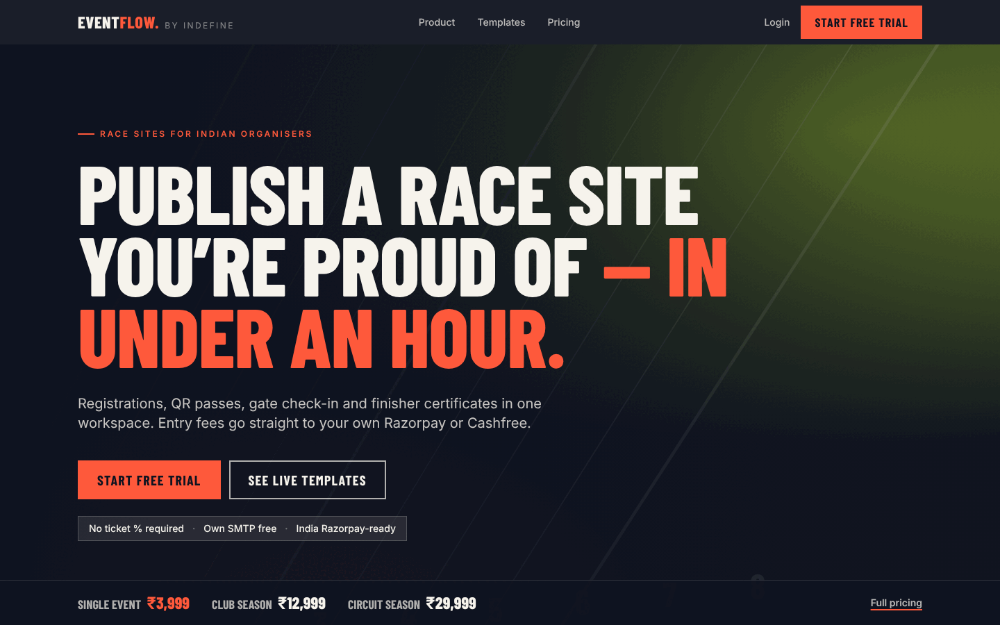
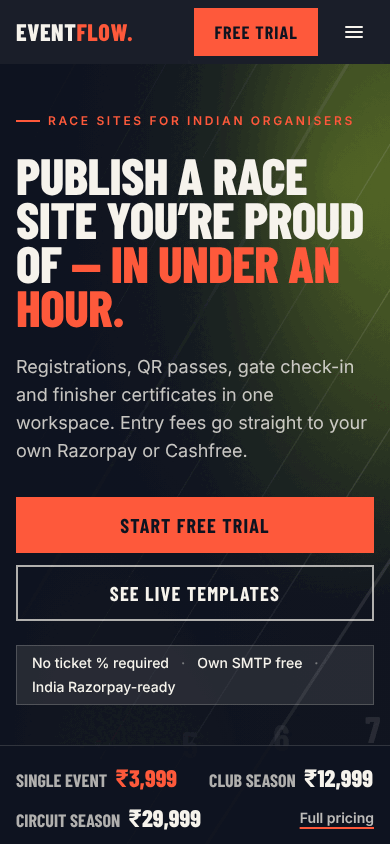
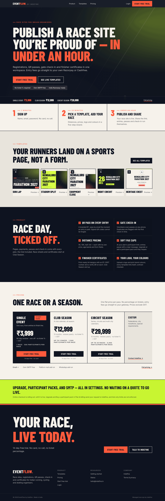
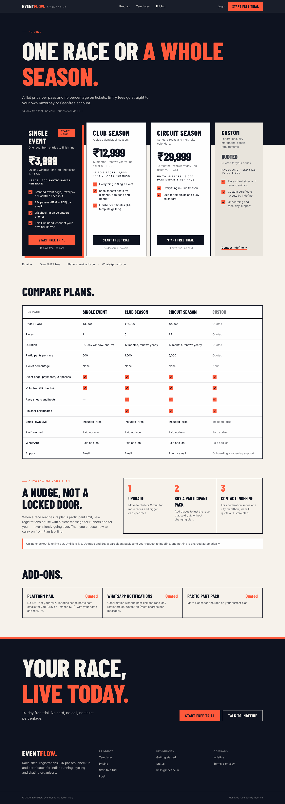
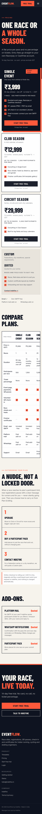
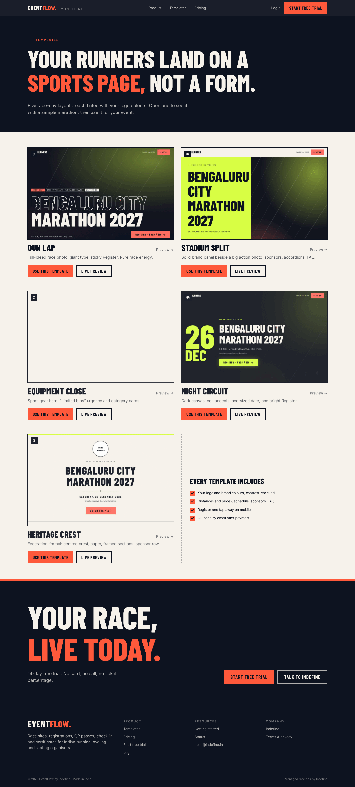
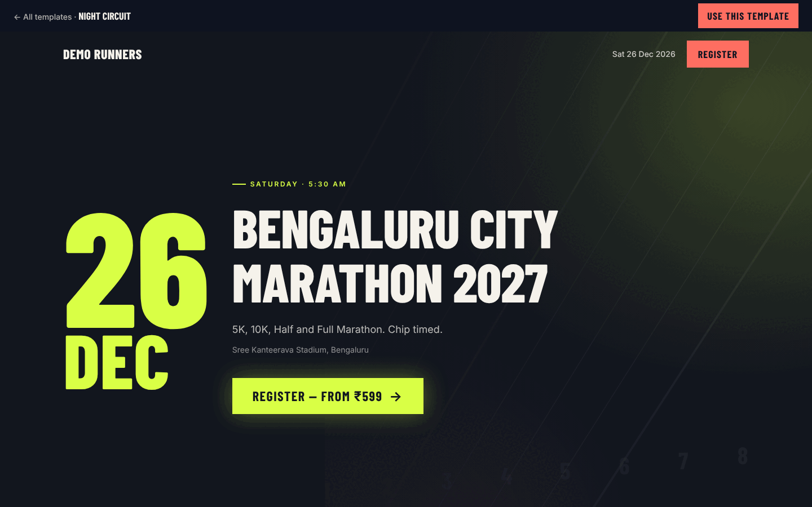
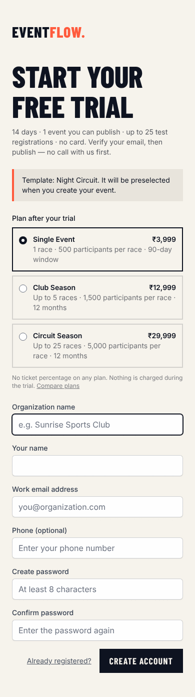

# Homepage SaaS: self-serve homepage and trial funnel (Session UX-H)

The marketing site sells EventFlow to organisers who sign up and publish on their own.
It uses the Race Ink system ([race-ink.md](race-ink.md)): ink, paper, Heat for the one primary
action, volt for emphasis bands. Pricing, caps and add-ons are Session M2's (`config/plans.php`); this page only presents them. Violet Track is kept off the marketing pages (no purple SaaS look).

## Funnel

```
/  ──► /templates ──► /templates/{key} ──► "Use this template"
│                                              │
└──► "Start free trial" ──► /register[?plan=&template=] ──► /account/plan?welcome=1[&template=]
                                                            └──► /organiser/events/create?template=  (preselected)
```

No "Book a demo" gate and no human step before the first publish. "Talk to Indefine" appears only
as a secondary action, and Custom is the last, quietest pricing column.

## Homepage order

1. **Nav**: Product · Templates · Pricing · Login · Heat **Start free trial** ("Free trial" under 640px).
2. **Hero**: "Publish a race site you're proud of — in under an hour."; one sub-line; Heat
   *Start free trial* → `/register`, ghost *See live templates* → `/templates`; proof chip
   "No ticket % required · Own SMTP free · India Razorpay-ready".
3. **Price line** in the hero foot: Single ₹3,999 · Club ₹12,999 · Circuit ₹29,999 · Full pricing.
   Single is above the fold at 1440×900 and 390×844.
4. **Time to value**: Sign up (2 min) → Pick a template, add your race (20 min) → Publish and share (under an hour).
5. **Template teaser**: five cards → `/templates/{key}`, "Your runners land on a sports page, not a form."
6. **Product proof**: QR pass, gate check-in, distance pricing, soft pax caps, certificates, logo colours.
7. **Pricing strip**, Single first and marked "Start here"; Custom de-emphasised;
   "Email ✓ · Own SMTP free · Platform mail add-on · WhatsApp add-on"; Full pricing link.
8. **Self-serve trust line** (volt band): "Upgrade, participant packs, and SMTP — all in settings.
   No waiting on a quote to go live." Followed, while `TRIAL_STUB=true`, by a note that checkout is rolling out.
9. **CTA band**: Heat *Start free trial*, ghost *Talk to Indefine*.
10. **Footer**: Product, resources (docs when configured, getting started, status), Indefine and legal,
    and a quiet "Managed race ops by Indefine" link.

## Not lying

Everything the pages promise is either built or labelled:

| Promise | Status |
|---|---|
| Prices, races, windows, pax | `config/plans.php` (locked in Session M2), the only source |
| No ticket % | No plan has a percentage; organisers pay a flat price per pass |
| Own SMTP free | Every plan; Settings → Notifications → SMTP |
| Soft pax caps | `App\Saas\PlanLimits` pauses registrations at the plan's participant limit (M2) |
| Certificates, race sheets | Club Season and up; the homepage says so |
| Publish without a call | Signup → verify email → wizard publishes; no approval step |
| Trial limits (14 d, 1 event, 25 regs, watermark) | `App\Saas\Trial`; banner on the dashboard and `/account/plan` |
| Upgrade / participant packs in settings | Plan & billing has **Upgrade**, **Buy a participant pack** and **Contact Indefine**. Online checkout is not built: until it is, those send the request to Indefine (M2), `TRIAL_STUB=true` keeps trial-only limits from blocking, and the homepage, pricing page and Plan & billing say so |
| Platform mail / WhatsApp / participant pack prices | `null` in config, shown as "Quoted" / "Paid add-on" |

## Screenshots

Desktop 1440 px, first fold:



Mobile 390 px, first fold (price line visible):



Full homepage:



Pricing, desktop and mobile:




Template gallery and a public preview with the "Use this template" bar:




Signup carrying a template:



Photos: the stock photo hosts were not reachable while these were taken, so heroes show the graded
graphic fallback (`components/ri/partials/fallback`). Real photos in `public/images/race-ink/<set>/`
replace it automatically.

## Template thumbnails

`public/images/templates/<key>.jpg` (1280×800) are crops of `/templates/{key}`. To regenerate:

```bash
php artisan serve --port=8127   # in another terminal
node scripts/template-thumbnails.cjs
```
