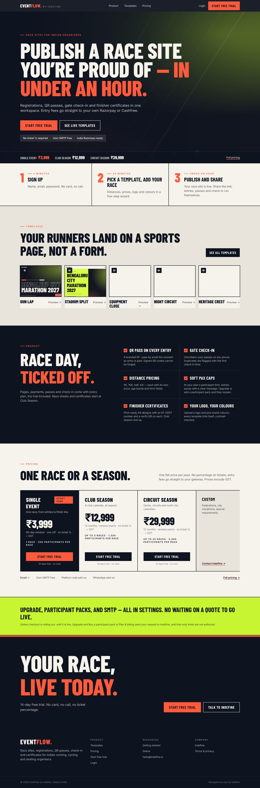
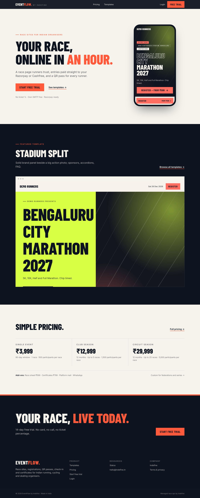
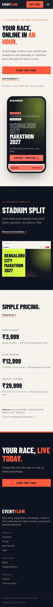
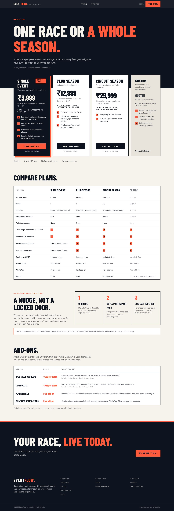
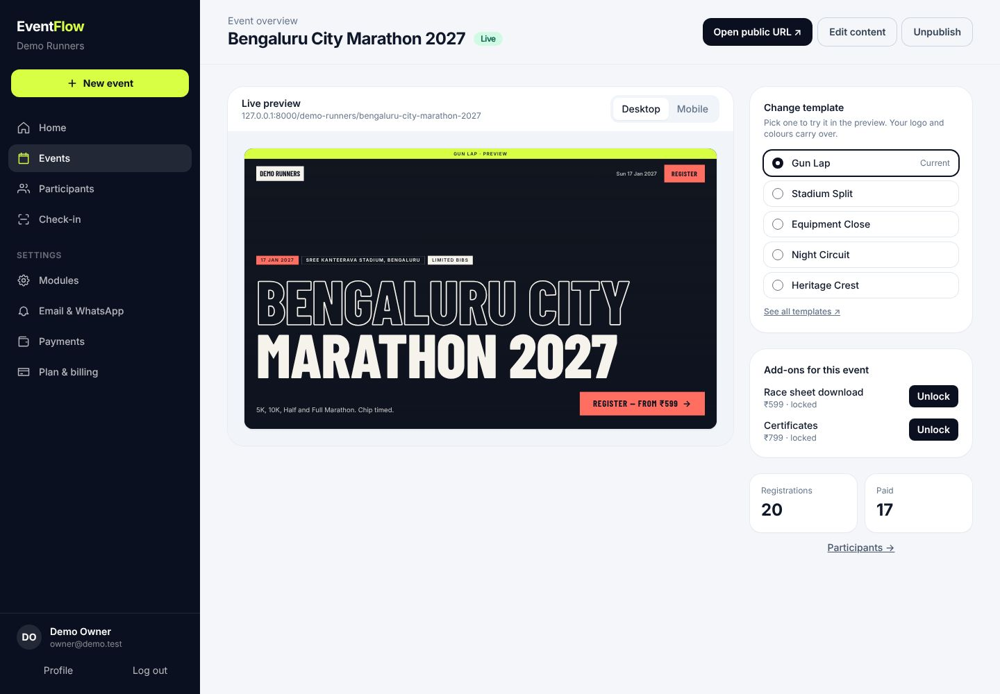
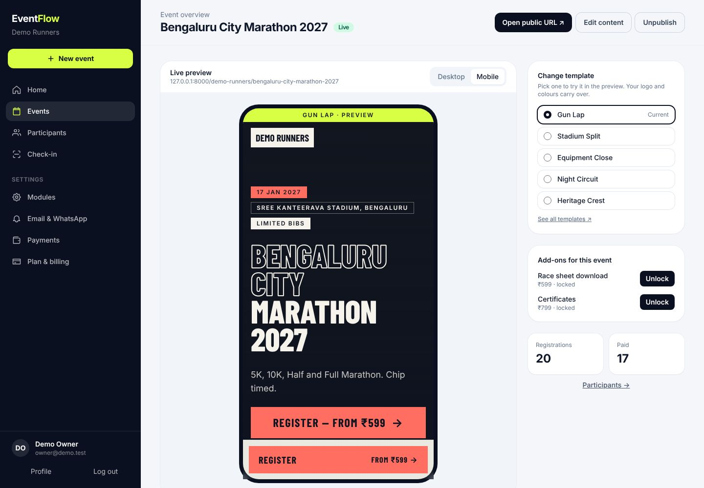
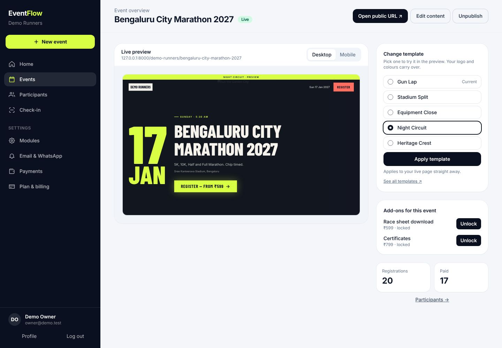
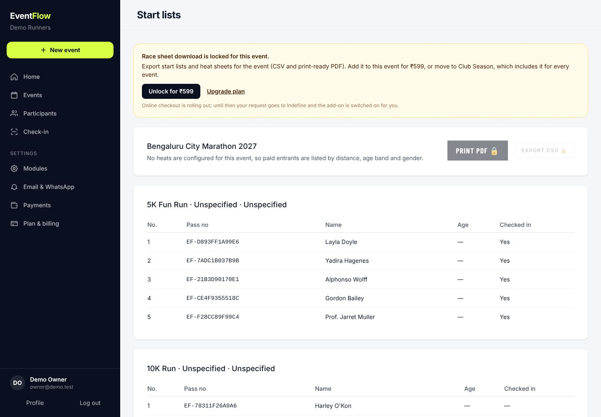

# Slim premium homepage (Session UX-H2)

The first Race Ink homepage stacked seven bands: a hero with a chip bar, a price line, three steps,
a five-card template grid, a six-item checklist, a second pricing strip, a lime trust band and a
two-button CTA. It read like a theme store. This pass keeps the Race Ink tokens and strips `/` back
to four calm bands with a lot of air.

## Rules

1. **Nav:** Logo · Pricing · Templates · Login · Heat **Free trial**. No "Product" anchor.
2. **Hero only:**
   - one headline, one short sub, **Start free trial**, and a text link "See templates →";
   - one proof line ("No ticket % · Own SMTP free · Razorpay-ready"), not a chip pile;
   - one device: a phone showing a Race Ink page (Gun Lap).
3. **One featured template:** Stadium Split, large, in a browser frame, with "Browse all templates →".
   The full gallery lives only on `/templates`.
4. **Quiet pricing:** three prices (Single / Club / Circuit) with term and caps, Custom as a text
   link, and one line: *Add-ons: Race sheet ₹599 · Certificates ₹799 · Platform mail · WhatsApp*.
5. **Final CTA:** one Heat button. Contact Indefine is never a primary CTA, on any page that uses
   the shared CTA band.

`tests/Feature/Marketing/SaasTest.php` checks:
- the bands are exactly `hero`, `featured-template`, `pricing`, `cta`;
- there is no template card on `/`;
- the CTA band has one link and no `mailto:`;
- the nav order.

## Before → after

| Before (7 bands) | After (4 bands) |
|---|---|
|  |  |

Mobile, where it most needed to breathe:

| Before | After |
|---|---|
|  |  |

## `/pricing`: add-ons

The M2 plans are unchanged. The Add-ons section is now a table:

| Add-on | Price | What |
|---|---|---|
| Race sheet download | ₹599 per event | Export start lists and heat sheets (CSV, PDF) |
| Certificates | ₹799 per event | Generate, download and reissue the premium certificate pack |
| Platform mail | paid add-on | Indefine sends participant mail when you don't use your own SMTP |
| WhatsApp | paid add-on | Confirmation and reminders on WhatsApp |

In the comparison table, Single Event's race sheet and certificate cells read "Add-on ₹599 / event"
and "Add-on ₹799 / event". Club Season and up include both.

## Dashboard: Event → Overview with live preview

`/organiser/events/{id}` embeds the event's own public page:
- **Live preview:**
  - an organiser-only render that shows drafts too;
  - a **Desktop / Mobile** toggle;
  - the event's template plus the organiser's logo and colours.
- **Actions:** Open public URL, Change template (try it in the preview, then **Apply template**),
  Edit content, Publish / Unpublish.
- **Add-ons panel:** each add-on shows as *Included in your plan*, *Added to this event*, or *₹X · locked* with **Unlock**.

| Desktop | Mobile |
|---|---|
|  |  |

Trying Night Circuit before applying it:

Without the plan module or the add-on, the race sheet stays viewable but downloads are locked:

