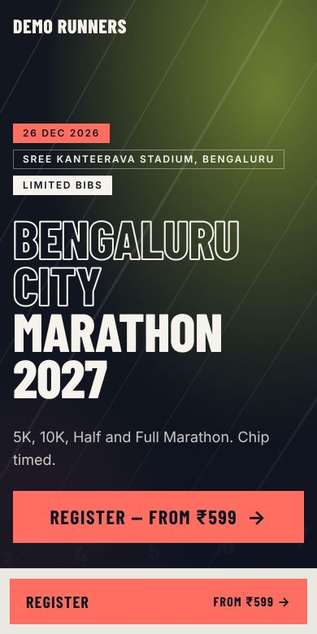
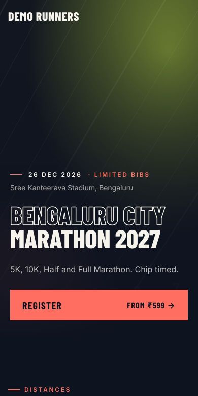
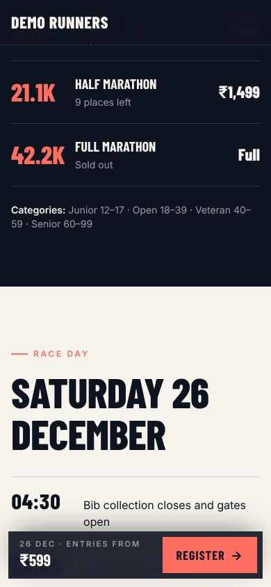
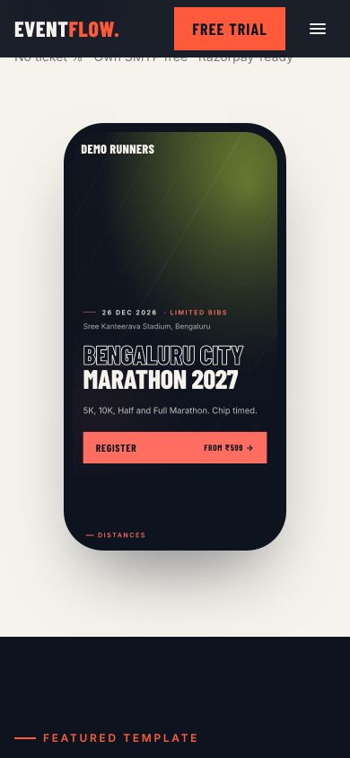
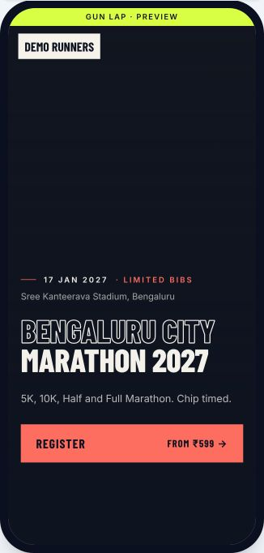
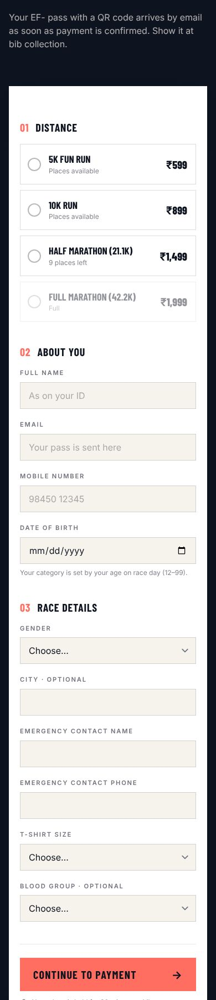
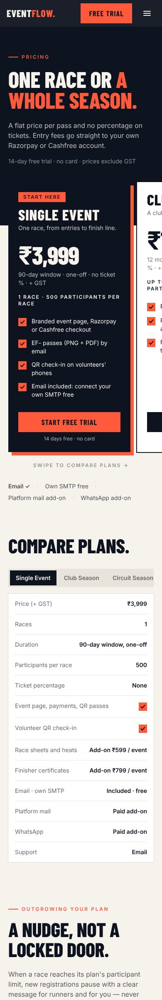
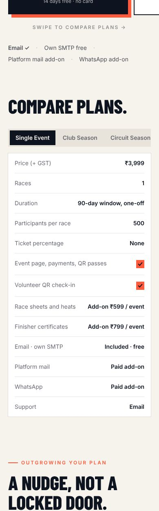

# Premium mobile polish for event pages

Feedback: on a phone, the race page (in the homepage phone mock and in the dashboard preview)
didn't feel premium. The causes and the fixes:

| Problem on a phone | Fix |
|---|---|
| Two Register buttons on screen at once (the hero button plus the sticky bar) | The sticky bar (`landings/partials/sticky-register`, every template) slides in only once the hero button (`[data-hero-cta]`) has scrolled away, and steps aside over the registration form. Without JavaScript it stays visible. |
| The sticky bar was a coral block on a light strip | A slim solid ink bar: "26 Dec · Entries from ₹599" on the left, one Heat **Register →** button, and safe-area padding for notched phones. |
| Gun Lap hero: three boxed chips stacked on separate lines | One quiet line on phones: date · Limited bibs, with the venue below. The chips stay on tablet and desktop. |
| Oversized outline headline | A smaller headline (13vw), tighter leading and a thinner outline stroke on phones. |
| Hero filled the screen with empty fallback | The hero is 86% of the screen height on phones, so the next section peeks in. The fallback line work is fainter on phones. |
| Distances: the price dropped under a huge numeral | One tidy row per distance: numeral, then name and places left, then the price on the right. |
| Dashboard mobile preview squeezed and clipped on a phone | The preview renders a real 390×844 page and scales it to fit, inside a phone frame. |
| The homepage phone mock was very large on phones | It is smaller on phones and re-captured from the new design. |

## Before → after (Gun Lap, 390px)

| Before | After |
|---|---|
|  |  |

After scrolling, the slim bar appears. The distance rows are tidy:

Homepage phone mock, and the dashboard's mobile preview on a phone:

| Homepage | Dashboard preview |
|---|---|
|  |  |

## The rest of the mobile site

| Page | On a phone, before | Now |
|---|---|---|
| Registration form (all 5 templates) | Generic thin-bordered admin inputs, tiny labels, a cramped white box | Numbered sections (01 Distance · 02 About you · 03 Race details); distance cards with the price on the right and a dark selected state; 48px inputs with 16px text (no iOS zoom); uppercase micro-labels; radio options as tap-sized chips; a full-width "Continue to payment →" with the hold note |
| `/pricing` | Four full plan cards stacked into an 8,000px page; a comparison table running off the right; the add-ons table squeezed into slivers | Plans are a swipeable row with the next card peeking ("Swipe to compare plans →"); the comparison is a plan switcher with a clean label/value list; add-ons are cards; tighter headline sizes. About 5,300px |
| Equipment Close distances | Four tall cards, one per screen | A compact two-up grid (the sticky bar carries Register) |
| `/` | "ONLINE IN AN / HOUR." broke awkwardly; the footer was one long column | "Online in / an hour." stays together; the footer link lists sit in two columns |
| Login and sign-up | A small right-aligned button | A full-width primary button, with the secondary link below |

| Form | Pricing | Compare |
|---|---|---|
|  |  |  |

Tests: `tests/Feature/Events/MobileLandingTest.php`.
