# Race Ink — EventFlow design system

Race Ink is the sports-editorial look for EventFlow's two public surfaces:

- **(A) the SaaS marketing site** for organisers (`/`, `/pricing`, auth);
- **(B) per-event "playing pages"** for runners (`/{org}/{event}`).

The dashboard keeps its quieter chrome: same fonts and tokens, less energy.

## Tokens

Defined as CSS variables (space-separated RGB) in `resources/css/app.css`. Tailwind exposes
them in `tailwind.config.js`, so `bg-heat`, `text-ink/70` and `ring-track` all work.

| Token | Value | Use |
| --- | --- | --- |
| `ink` | `#0E1320` | Text, dark sections, rules |
| `track` | `#5B4CFF` | Brand panels and highlights (`on-track` text) |
| `track-text` | `#5B4CFF` | Track used as text on paper, always 4.5:1 or better |
| `heat` | `#FF5A3C` | Register and primary CTAs, urgency (`on-heat` = ink, 6:1) |
| `paper` | `#F6F3EC` | Page background |
| `mist` | `#E8E4DC` | Secondary bands (sponsors, register) |
| `midnight` | `#12161F` | Dark canvases (Night Circuit, photo fallbacks) |
| `volt` | `#C8F531` | Sparing accent on dark only |

**Type.** Barlow Condensed 600–800 (display: `font-display`, `.ri-headline`) and Inter 400–700
(UI). Both are self-hosted through `@fontsource`, so there is no font CDN on any page.

**Motion.** `data-reveal` blocks fade up as they scroll in, and `.ri-kenburns` slowly settles
hero photos. Both only run under `prefers-reduced-motion: no-preference`; otherwise content is
static and visible.

**UI kit** (`resources/views/components/ri/`): `<x-ri.button variant="heat|ink|track|light|ghost|ghost-light">`,
`<x-ri.chip>`, `<x-ri.accordion>` (native `<details>`), and `<x-ri.photo>` (photo or graded
graphic fallback). Utility classes: `.ri-headline`, `.ri-kicker`, `.ri-grade`.

## Organiser colours on event pages

`App\Landing\Theme::raceInk()` tints the tokens per event and checks every result:

- **Track** comes from the brand primary. Its text colour (ink or white) is picked for 4.5:1;
  if neither reaches that, the colour is darkened towards ink.
- **Heat** comes from the brand secondary, with text at 3:1 or better. Heat buttons are always
  20px bold, which counts as WCAG large text.
- **Track-text** is the primary darkened until it reads at 4.5:1 on paper. Lime becomes olive.
- **Volt** is the primary or secondary if it reaches 7:1 on midnight, otherwise `#C8F531`.
- Greys and near-blacks (not vivid enough) keep the Race Ink defaults, so a slate secondary
  never turns Register grey.

`tests/Feature/Events/LandingTemplatesTest.php` checks these ratios for several brand pairs.

## Event page templates

| ID | Name | Character | Pack default |
| --- | --- | --- | --- |
| `gun-lap` | Gun Lap | Full-bleed race photo, giant outline-over-solid type, start-list distances | running |
| `stadium-split` | Stadium Split | Solid Track panel + big action photo, sponsor strip, accordions | generic |
| `equipment-close` | Equipment Close | Gear close-up hero, "Limited bibs", category cards with availability bars | skating |
| `night-circuit` | Night Circuit | Midnight canvas, oversized date, volt Register, lit lanes | cycling |
| `heritage-crest` | Heritage Crest | Centred crest, paper, double-ruled frames, order of events, notices | — |

Every template has:

- the organiser logo slot;
- a hero, distances with prices and places left, schedule and venue;
- Register (desktop sticky header, mobile bottom bar, and the form at `#register`);
- FAQ, and sponsors or "Organised by".

Old keys (`aurora`, `midnight`, `clean`, `festival`, `heritage`) render as `gun-lap`,
`night-circuit`, `stadium-split`, `equipment-close` and `heritage-crest`
(`eventflow.landing_template_aliases`). A custom template is a "Contact Indefine" request.

New optional event YAML (schema in `events/schema.json`):

```yaml
schedule:                  # else: bib collection 1h before, one start per distance
  - { time: "05:30", label: Full Marathon flag-off }
sponsors:                  # else: "Organised by <org>"
  - { name: Garden City Sports, tier: Title partner, logo: branding/acme/sponsor.png, url: https://… }
charity: Every entry plants a tree with …
```

## Photography

`App\View\SportImagery` serves `public/images/race-ink/<set>/*.jpg`. The sets are `running`,
`cycling`, `skating`, `generic` and `marketing`. An organiser's hero upload always wins. With
no photos, `<x-ri.photo>` draws a graded sport-line graphic, so the layouts never show an empty
box. Photo rules and the credit log are in `public/images/race-ink/CREDITS.md`.

> The screenshots below use the graphic fallbacks. Stock photography is still to be added; the
> build environment could not reach image hosts.

## Before / after

### Marketing home
| Before | After |
| --- | --- |
| 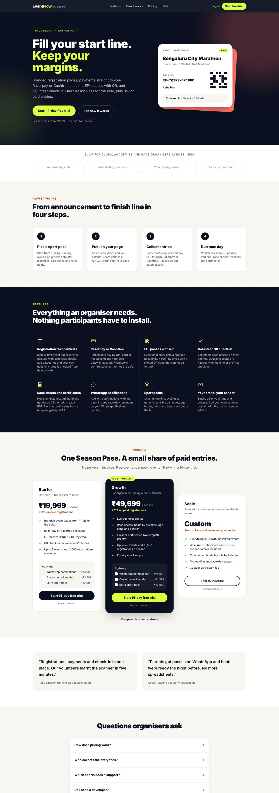 | 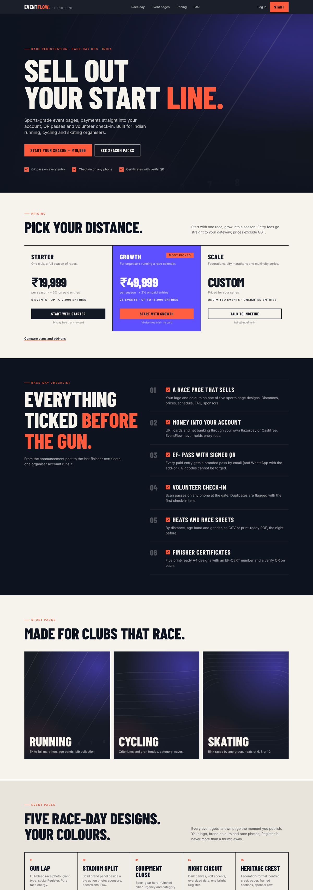 |

### Pricing
| Before | After |
| --- | --- |
| 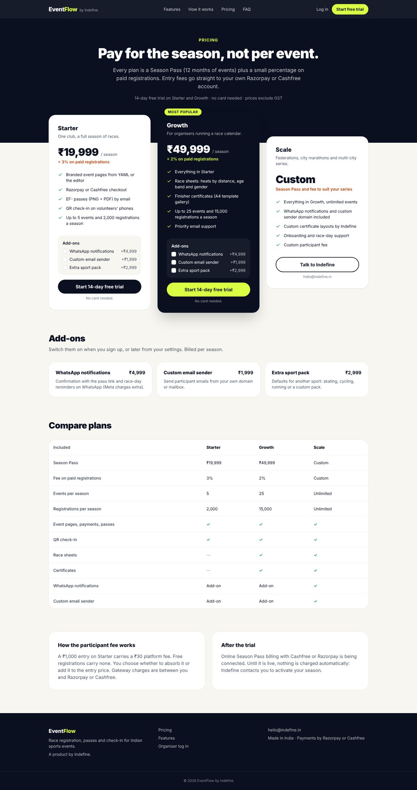 | 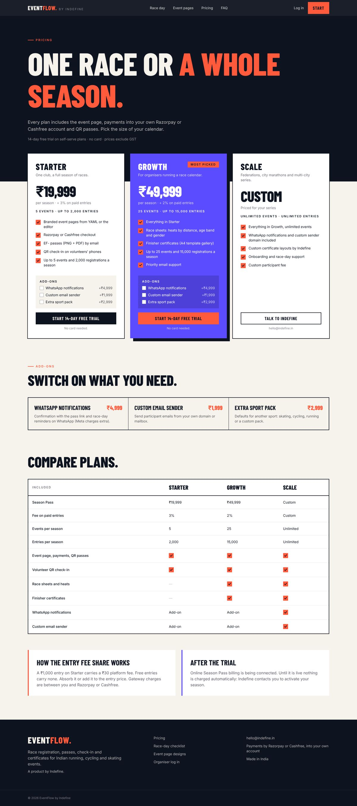 |

### Log in
| Before | After |
| --- | --- |
|  | 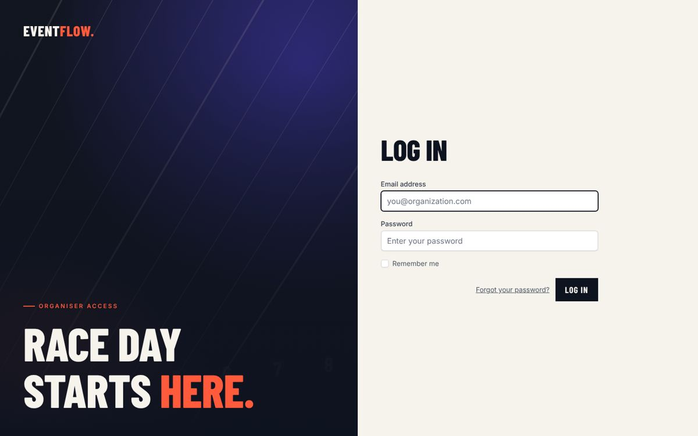 |

### Event pages
| Before (Aurora, Midnight, Clean, Festival, Heritage) | After |
| --- | --- |
| 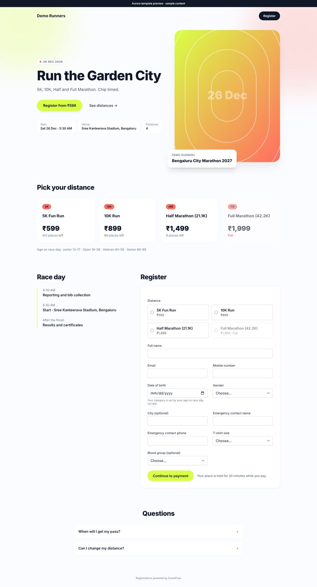 | 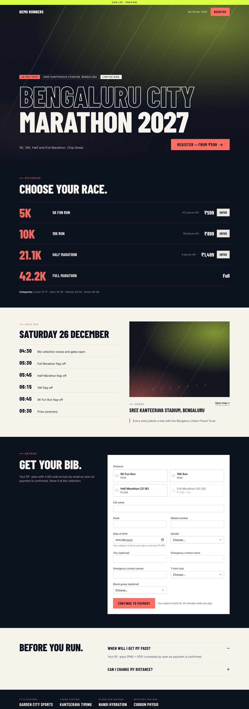 |
| 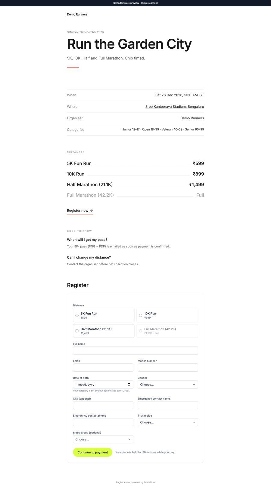 | 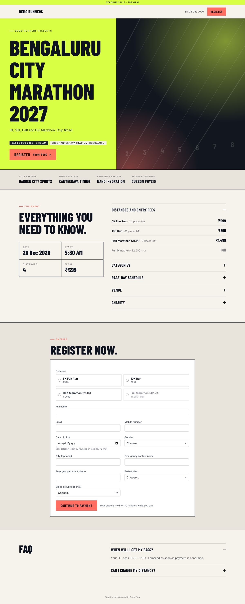 |
| 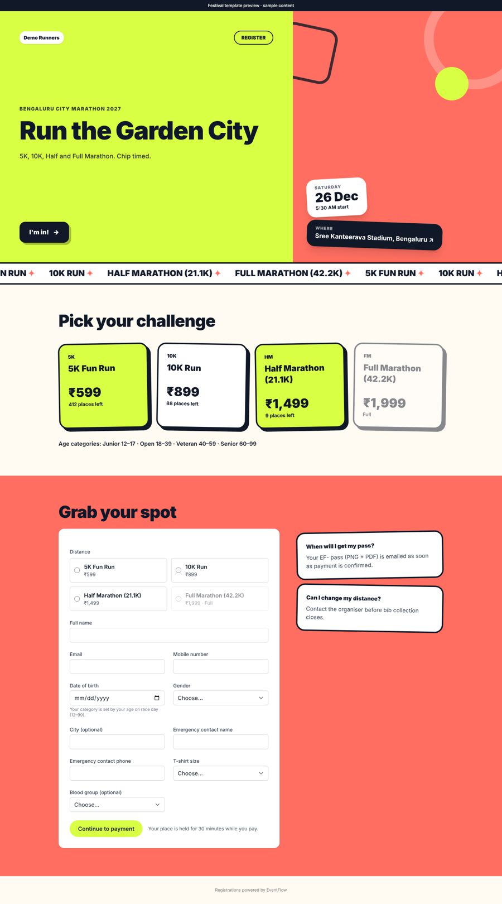 | 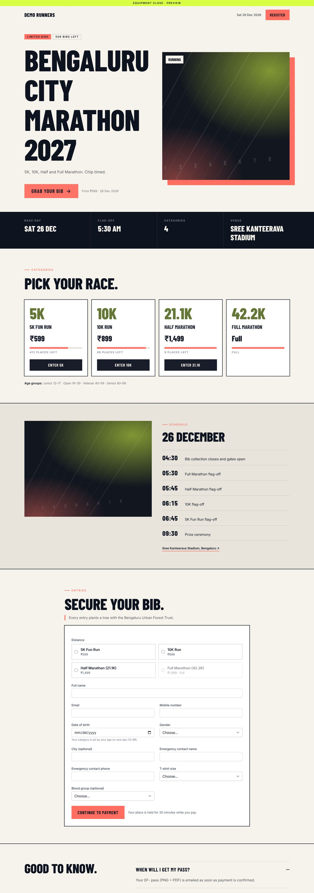 |
| 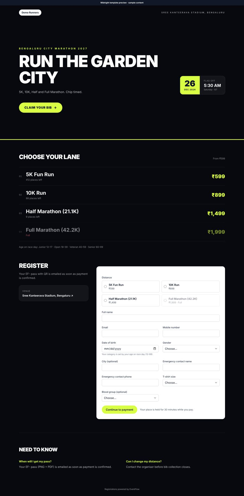 | 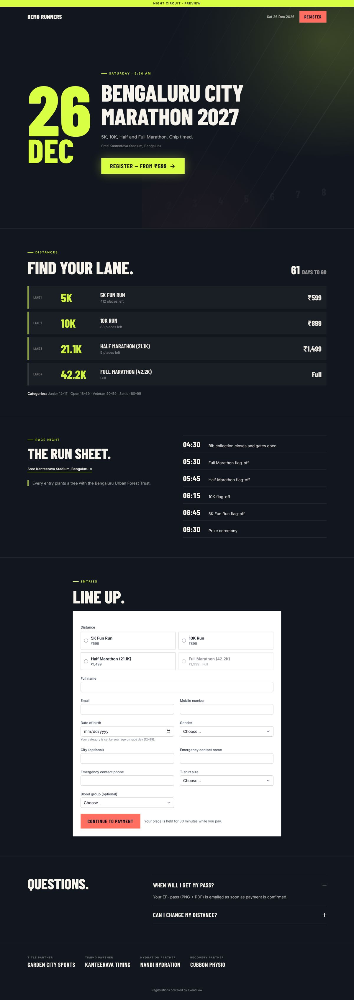 |
| 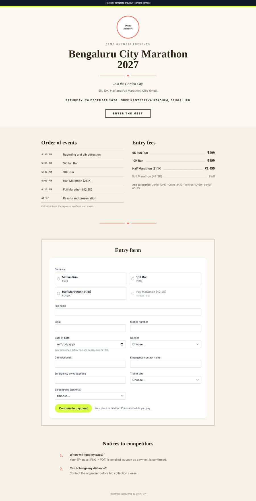 | 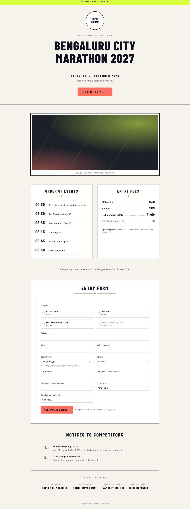 |

### Mobile (390 px): home and the five event pages
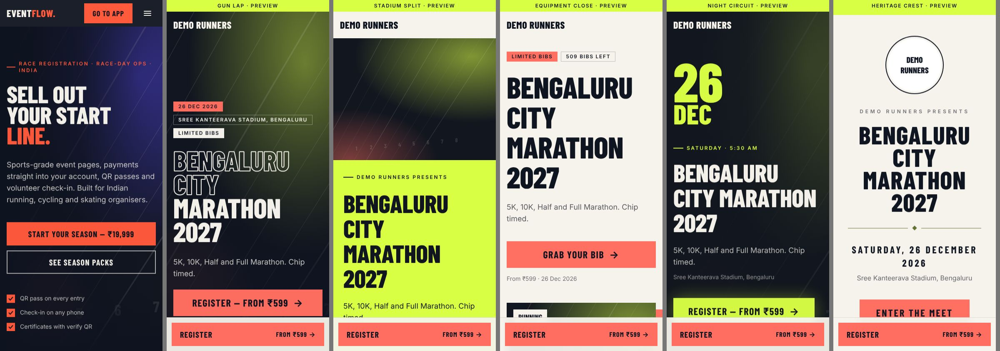
